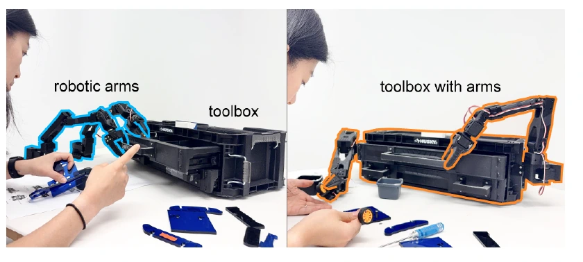
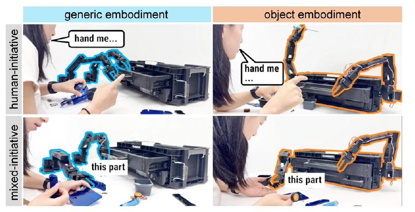
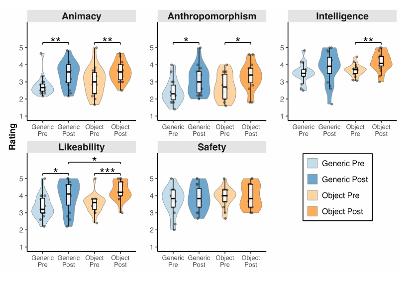

## Abstract

Robots are entering everyday life in increasingly diverse forms, from mobile manipulators and humanoids to robotic furniture, objects, and spaces. We study how such embodiments shape user perception during physical collaboration through an exploratory Wizard-of-Oz study (N = 16), comparing object-embodied manipulation (a toolbox with arms, a kitchen bookstand with arms) with generic standalone arms, across mixed-initiative and human-initiative-only styles. Users characterized object embodiments as unified entities with contextual expertise (10 of 16 participants), whereas generic arms were perceived as separate tools. Object embodiments were rated more likable (p = 0.049), and perceived intelligence increased after collaboration only for object embodiments (p < 0.01). Initiative style did not significantly affect fluency, but participants valued assistance that fell into two functional categories cutting across styles, supporting user decisions through guidance and confirmation, and reducing user workload through anticipatory action, secondary assistance, and independent task contributions. These findings suggest that embedding robotic capabilities into task contexts can change how users conceptualize robot collaborators.

## What if the toolbox could help?

Imagine you're working on an assembly task, and a standalone robotic arm reaches into a toolbox, picks up a tool, and hands it to you. 

That would be nice, but ...  what if the robot could blend more into the task, as if it were part of the toolbox itself? Would it feel like the toolbox itself was collaborating with you?

<figure>
  
  <figcaption>Paper Fig. 1. A standalone arm and a toolbox with arms can assist with the same assembly task.</figcaption>
</figure>

We asked **\<whether embedding arms in objects that already belong in a task\>** changes **\<how people understand the robot and its help\>.**

## Comparing Form & Initiative

**16 participants** assembled small objects and prepared no-bake desserts. 
Participants experienced each combination of form and initiative, with tasks and order counterbalanced.

<figure>
  
  <figcaption>Paper Fig. 2. The study varied embodiment and who could initiate assistance.</figcaption>
</figure>

- In the ObjectLimb condition, arms were integrated into a toolbox or a kitchen bookstand. 
- In the GenericLimb condition, the arms stood separately. 

- In Human-Initiative condition, the robot acted only when the person requested help. 
- In Mixed-Initiave condition, either partner could initiate assistance. A hidden operator controlled the robots with consistent task knowledge across conditions. 

This 2 by 2 study enable us to learn **how people perceived the two forms and initiative styles** without introducing differences in autonomous capability.

## Object --> Collaborator

**10/16** participants described the object embodiments as a **unified entity**. **8** attributed task-specific expertise to them. 
The toolbox could feel like it knew something about assembly, even though the same operator and task knowledge were used in both setups.

After collaboration, participants rated the object embodiments **more likable** than the standalone arms (4.28 vs. 3.96, p = .049). 
Perceived intelligence increased from before to after the study for the object embodiments (p = .002), while the change for standalone arms was not significant. The post-study intelligence difference between the two forms did not reach significance.

<figure>
  
  <figcaption>Paper Fig. 5. Perceptions before and after working with each form.</figcaption>
</figure>

## What people valued in the help

Neither initiative style nor embodiment significantly changed reported collaboration fluency. In interviews, people described **2 types of useful help** that appeared across initiative styles:

<assistance-figure></assistance-figure>

Our exploratory study also suggests **2 questions for designing a collaborator**:
- What expertise does the robot’s form lead people to expect? 
- What burden does its help remove? 

The results come from a small, teleoperated study, so those expectations still need testing with autonomous systems and other objects.

## Acknowledgment

This project was led by Violet Han, my brilliant labmate (who always helps me like a mentor) at the Interactive Structures Lab. Drawn to the research question, I facilitated the user study and project discussions.
