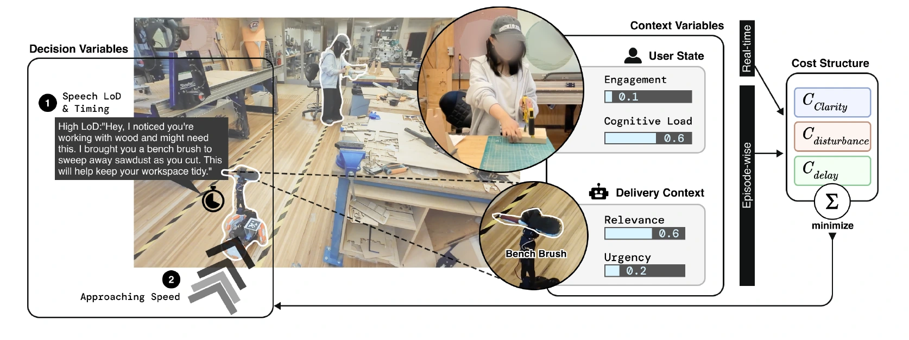
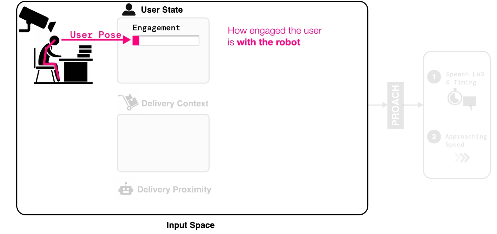
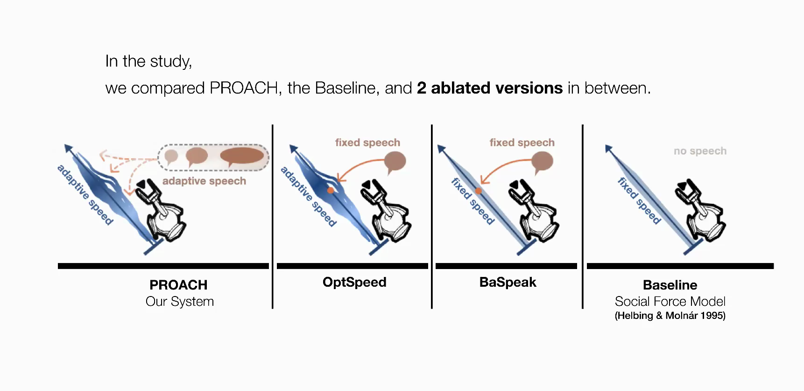
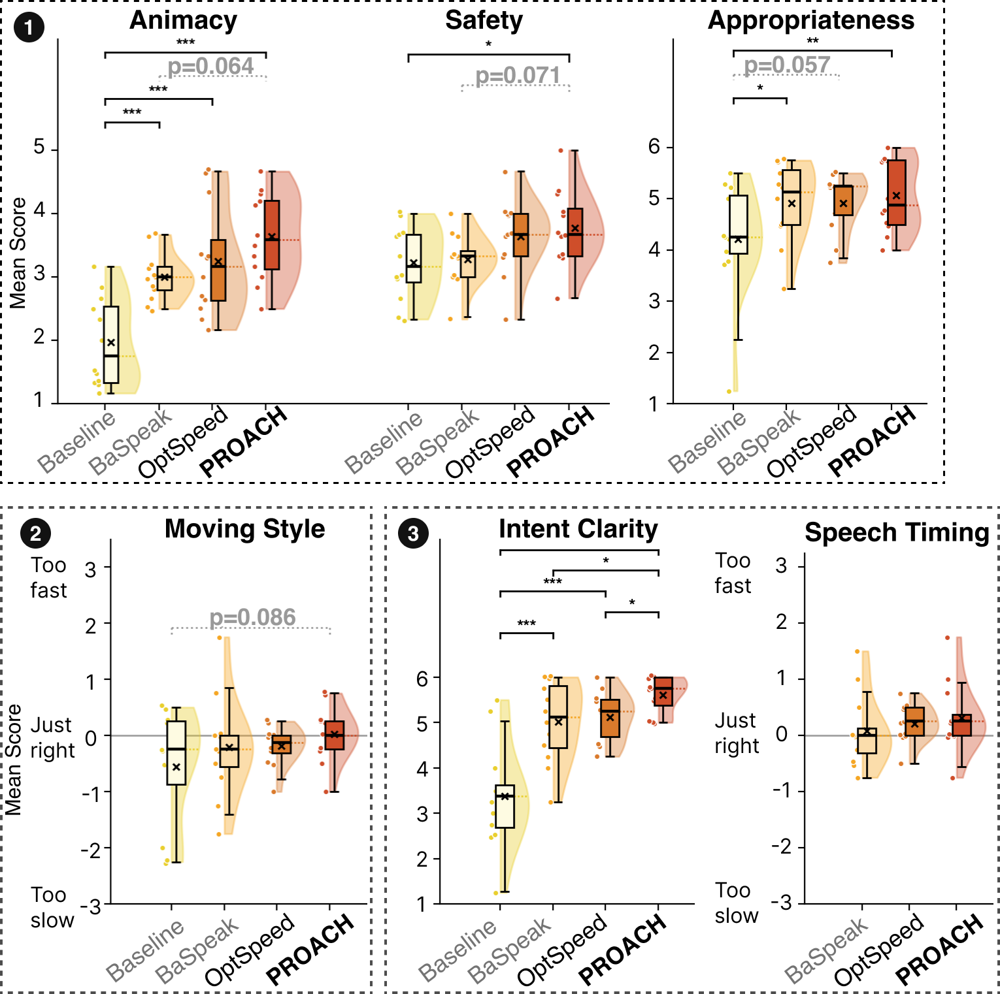
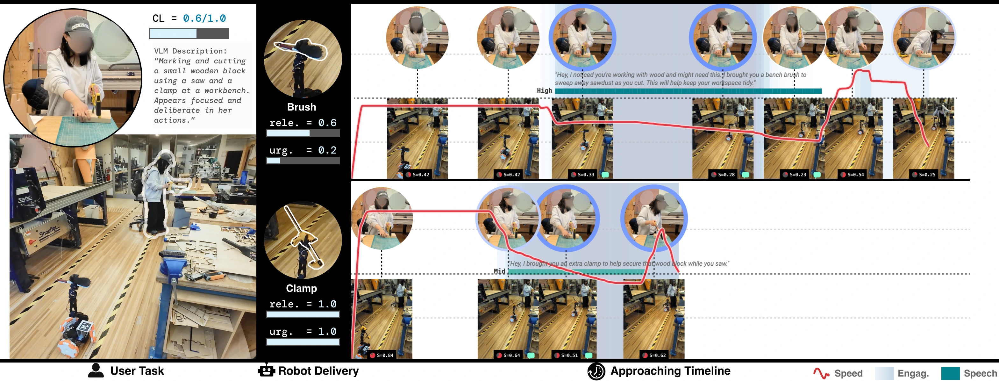
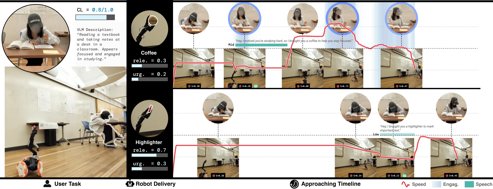
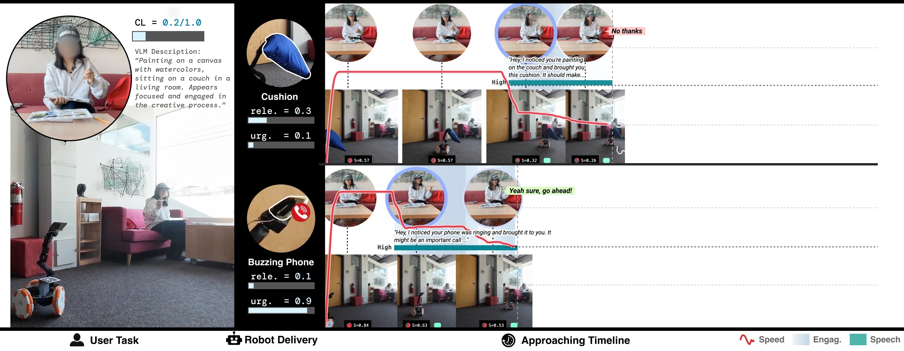

## Abstract

Robot assistants are increasingly capable of assisting users in everyday environments, yet they don’t take users’ cognitive context into consideration. As a result, proactive behaviors may interrupt users during cognitively demanding tasks, before they can acknowledge or respond. We identify this pre-acknowledgment window as a critical phase and introduce our real-time optimization approach that adapts how robots approach and communicate during this window, using user engagement signals and task context. Our system jointly optimizes movement and speech by solving structured, closed-form quadratic subproblems that balance disturbance, clarity, and efficiency online. This enables continuous adjustment of approach movement, timing of intent expression, and level of detail without explicit user input. In a within-subjects ablation user study (N = 12), we find that adapting speech to context improves intent clarity, that speed adaptation alone has limited impact without paired speech adaptation, and that coordinating both channels yields the strongest animacy. We also demonstrate the real-world application in three everyday scenarios.

## The moment before you look up

Imagine a robot bringing you a bench brush while you are cutting wood. It can help, but approaching quickly or speaking at the wrong moment can pull you away from the task. An urgent delivery, such as a tool you need right now, may justify a more direct approach.

**PROACH adapts the approach before the user explicitly responds.** It coordinates movement and speech as the situation changes, so the robot can make its purpose clear while leaving room for the user to react.

<figure>
  
  <figcaption>Paper Fig. 1. User and delivery context shape the robot’s movement and speech.</figcaption>
</figure>

## How PROACH makes a decision

The robot takes in **user state**, **delivery context**, and **distance**. It balances three competing costs: unclear intent, disturbance, and delay. Our optimizer runs online at **7 Hz**, continuously updating behavior parameters.

Choose **Input**, **Formulation**, or **Output** below, then select an individual component to see what it does.

<figure-explorer data-src="figures/system.json">
  <figure>
    
  </figure>
</figure-explorer>

## What we tested

In a within-subjects study, **12 participants** sorted and organized cards while a mobile manipulator delivered items that varied in urgency and relevance. Each participant experienced four versions: a silent baseline, fixed speech with baseline movement (**BaSpeak**), adaptive speed with fixed speech (**OptSpeed**), and jointly adaptive speed and speech (**PROACH**). Task context was set in advance for the study, while engagement was estimated live.

<figure-explorer data-src="figures/study.json">
  <figure>
    
  </figure>
</figure-explorer>

## Study findings

<figure class="proach-results-figure">
  
</figure>

**1. Joint adaptation gave the highest mean intent clarity and animacy.** PROACH scored significantly higher on intent clarity than both fixed-speech conditions.

**2. Speech was a key contributor to perceived appropriateness.** PROACH and BaSpeak both scored significantly higher than the silent baseline. BaSpeak used fixed speech.

**3. Adaptive speed alone showed limited benefit.** Adding adaptive speed to fixed speech did not significantly improve intent clarity over fixed speech alone. PROACH paired adaptive speed with adaptive speech.

**4. Movement style and speech timing showed no significant differences.** The demanding primary task and the small, demographically narrow sample (N = 12) may have made differences harder to detect.

## From the lab to everyday tasks

**Workshop.** While Sarah sawed a wood block, the robot brought a bench brush at a moderate pace and explained how it could help clear sawdust. It brought the clamp faster and with a shorter explanation because she needed to secure the block before continuing.

<figure class="proach-application">
  
  <figcaption>Delivery timelines for the bench brush (top) and the clamp (bottom).</figcaption>
</figure>

**Study space.** While Maya focused on her notes, the robot approached slowly with a highlighter and waited until it reached her desk to speak. In the coffee delivery, Maya had set down her pen and looked up, so the robot approached faster and spoke sooner.

<figure class="proach-application">
  
  <figcaption>Delivery timelines during a break (top) and sustained focus (bottom).</figcaption>
</figure>

**Living room.** The robot approached Lily at a moderate pace with a cushion, giving her time to decline before the handoff. When her phone buzzed, it approached quickly and drew her attention. She interrupted its explanation to accept the phone.

<figure class="proach-application">
  
  <figcaption>Delivery timelines for the declined cushion (top) and the accepted phone (bottom).</figcaption>
</figure>

Refer to our [paper](PROACH_UIST26.pdf#page=9) or [video](https://www.youtube.com/watch?v=IUVRtaTDW-0) to see the full scenarios and how the robot’s behavior changes over each approach.
